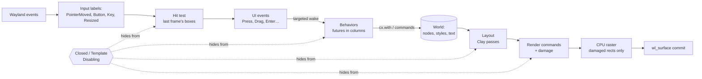

# static-ui: the plan

A retained, async, ECS-native UI on static-ecs: Clay's layout algorithm,
widget behavior written as straight-line async code, and every screen, menu,
and popup built once and switched on and off with `Disabling` components
instead of being rebuilt.

Sources this combines:

- [Async ECS UI Dreams](https://hackmd.io/@bevy/SJeIAtVneg): widget logic as
  futures awaiting events (`loop { await DragStart; select(Drag, DragEnd) }`),
  cleanup scopes, `animate`, racing I/O against input.
- [notgull, async GUI](https://notgull.net/async-gui/): events are things
  *waiting to happen*; the user picks the event plumbing.
- [Clay](https://github.com/nicbarker/clay): flexbox-like layout (`FIT`,
  `GROW`, `FIXED`, `PERCENT`, padding, gap, alignment, direction, floating,
  clipping, text wrapping, aspect ratio, transitions) in microseconds, with
  an arena and no allocation, emitting a sorted list of render commands.
- static-ecs: compile-time access, inlined systems, relations, hooks,
  in-schedule async tasks, and (as of `1f0428f`) default query filters.

Code below marked **SPECULATIVE** is the target API, not code that exists.

---

## 1. Goals and budgets

| Goal | Budget (to be measured, phase 8) |
|---|---|
| An idle UI does nothing | 0 wakeups, 0 frames, 0% CPU while nothing changes |
| Responsive layout | Clay's model: `GROW`/`PERCENT`/min–max adapt to any window size |
| Layout is cheap | ≤ 50 µs for 1,000 visible elements, ≤ 0.5 ms for 10,000; within 1.5× of clay.h on the same tree |
| Hidden UI is free | a closed panel costs nothing per frame: no layout, hit testing, rendering, or behavior polling |
| Toggling is cheap | opening or closing a 500-entity panel ≤ 100 µs, with no allocation once warm |
| Input to pixels | input handled, laid out, rastered and committed in the same wakeup; ≤ 1 ms for small damage, measured with `wp_presentation` |
| Small redraws | only damaged rectangles are rastered and reported to the compositor |
| Startup | first frame in the same range as `demo/flappy` (1.5 ms after launch) |
| Mistakes don't compile | widget behaviors' world access, missing components, conflicting systems: compile errors, as elsewhere in static-ecs |

Non-goals for now: GPU rendering (the render command list keeps it possible),
complex-script text shaping, accessibility trees, and platforms other than
Wayland.

## 2. The core idea, in one picture



Every UI element is an entity. Closing a panel inserts `Closed` (a `Disabling`
component) on its subtree. Every query in the pipeline — the tree flattening
for layout, hit testing, render command generation, behavior polling — simply
does not mention `Closed`, so the closed subtree disappears from all of them
with no code in any of them. Its component data (styles, shaped text, scroll
offsets, slider values) and its behavior futures (paused exactly where they
were awaiting) stay in place. Reopening removes `Closed`.

## 3. Visibility model: `Disabling` components as UI state

```rust
// SPECULATIVE
/// A panel the user closed: invisible, inert, its behaviors frozen.
pub struct Closed;
impl Disabling for Closed {}

/// A subtree kept only to be instantiated (list rows, dialog prototypes).
pub struct Template;
impl Disabling for Template {}
```

Rules:

- **Use `Disabling` for state that changes at human-interaction frequency and
  covers whole subtrees** (open/close a menu, switch a tab, show a dialog,
  park a pooled list row). Each toggle moves the subtree's entities between
  tables once.
- **Never use it for per-frame state** (hover, pressed, scrolled out of view):
  those change every frame and would move entities every frame. Hover and
  press are in-place component data; off-screen culling happens at render
  time, like Clay's.
- **`Disabled` stays for the app**, not for the toolkit's own bookkeeping, so
  user code that disables an entity never fights the UI.
- **Inspectors and editors see everything** with `MayHave<Closed>` /
  `MayHave<Template>`.
- **Name clash to avoid:** Bevy's `InteractionDisabled` means "visible but
  ignores input". Here that is `Inert`, an ordinary component that hit testing
  filters with `Without<Inert>`. It is not `Disabling`.

Closing a subtree: `ui.close(root)` inserts `Closed` on `root` and every
descendant, walking `From<ChildOf, (Entity, Has<Closed>)>`. The join mentions
`Closed`, so it can see already-closed children. `ui.open(root)` removes it.
Closing an already-closed subtree is a no-op.

**What this replaces:** in Clay (immediate mode) a closed dropdown is simply
not declared that frame, and reopening declares and re-measures it again. In
Bevy, closed UI is usually despawned and respawned, or kept with
`Visibility::Hidden`, which still costs layout and query time. Here, closed UI
costs nothing and reopening rebuilds nothing.

**Virtualized lists for free:** a scroll view over 10,000 items keeps only the
visible rows (plus margin) open and parks the rest in a pool under `Closed`.
Scrolling recycles pooled rows: rewrite their data, then `open`. No spawning
while scrolling.

## 4. Data model

All plain types; no derives.

| Component | Contents |
|---|---|
| `Node` | `direction`, `padding`, `gap`, `align: (AlignX, AlignY)`, `width: Sizing`, `height: Sizing` (`Fit{min,max}`, `Grow{min,max}`, `Fixed(f32)`, `Percent(f32)`) |
| `Background`, `Border`, `Radius`, `Overlay` | style; `Components<T, true>` so an unchanged column is skipped with one load |
| `Text` | string, font, size, color, wrap mode; plus a cached `TextLayout` (measured words, wrapped lines) that survives toggling |
| `Image`, `AspectRatio`, `Custom<T>` | as in Clay |
| `Clip { x, y }` + `Scroll { offset }` | scroll containers |
| `Floating { attach, offset, z, pointer_capture }` | tooltips, dropdowns, modals |
| `ChildOf` | `OneToMany`, `ACYCLIC`, `LINKED` (despawning a node despawns its subtree), ordered (phase 0) |
| `Rect` | layout output, written only when it changes, so `Changed<Rect>` drives damage |
| `Interaction { hovered, pressed, focused }` | updated in place; never moves the entity |
| `Inert` | visible but ignores input |

**Building UI without macros:** nested tuples spawn hierarchies; the shape is
a type, so spawning a widget tree has no dynamic dispatch.

```rust
// SPECULATIVE
const PANEL: Node = Node::column().padding(16.0).gap(8.0).width(Fixed(300.0)).height(GROW);

let sidebar = ui.spawn((
    PANEL, Background(GRAY),
    children((
        (Node::row().width(GROW), Text::new("Clay - UI Library", 24.0)),
        slider(0.0..=1.0),
        dropdown(["Low", "Medium", "High"]),
    )),
));
```

Styles are `const` values, as in Clay (`Clay_ElementDeclaration` at file
scope).

## 5. Layout: Clay's algorithm on a flattened tree

### 5.1 Flattening (only when structure changes)

A `LayoutTree` resource holds the visible tree as struct-of-arrays in
breadth-first order: parent index, first child, child count, sizing,
padding/gap/alignment, measured and final sizes, positions. Each node entity
holds a `LayoutIndex(u32)` into it.

It is rebuilt only when the structure changes: `Relinked<ChildOf>`, a node
spawned or despawned, `open`/`close`, or a `Node` change that alters
structure (floating attach). The rebuilding query does not mention `Closed`,
so closed subtrees never enter the arrays. Between rebuilds, `Changed<Node>` /
`Changed<Text>` rows patch their array slots in place.

The passes then run over plain arrays, with no entity lookups, like Clay's arena.

### 5.2 Passes (from `Clay__CalculateFinalLayout`)

1. **Fit sizes, bottom-up** (Clay does this as elements close): each `Fit`
   node's size along its layout axis is the sum of its children plus padding
   and gaps; across the axis, the largest child. Text contributes its
   unwrapped width and minimum word width. Reverse breadth-first order.
2. **Width, top-down** (`Clay__SizeContainersAlongAxis(x)`):
   - `Percent` children take a share of the parent's content size.
   - Along the layout axis, if children overflow, shrink the largest
     resizable children first, equalizing them, never below their minimum.
     Clipping parents don't shrink children.
   - If children underflow, grow the smallest `Grow` children first,
     equalizing them, never above their maximum.
   - Across the axis, `Grow` fills the parent, clamped to min/max (to the
     content size inside a scrolling parent).
3. **Wrap text** to the final widths, using the cached measured words.
4. **Propagate heights bottom-up** (wrapping changes heights).
5. **Height, top-down** (same as step 2, y axis).
6. **Aspect ratio** fix-up.
7. **Positions, depth-first**, with alignment, scroll offsets, and floating
   attach points. Floating roots are sorted by z.
8. **Write back `Rect`** only for nodes whose box changed.

Text measurement goes through a word cache keyed by (font, size, word), like
Clay's `measureTextCache`. Because nodes persist, a node's measured words
survive between frames and across open/close, instead of being re-hashed
every frame.

### 5.3 Incremental layout

- **v1:** if nothing is dirty, skip layout entirely. Otherwise relayout the
  whole visible tree. Clay's numbers say this is microseconds; measure before
  optimizing.
- **v2: relayout boundaries.** A node whose size cannot depend on its
  content (`Fixed` on both axes, or a clipped scroll container) isolates its
  subtree. A change inside it relayouts only that subtree. Changes that
  bubble a `Fit` size up stop at the first boundary.

### 5.4 Verifying the port against Clay

A test-only crate compiles `clay.h` (with `cc`, as a dev dependency only),
builds the same randomized trees through Clay and through static-ui, and
compares every box within an epsilon. Trees vary sizing kinds, min/max,
padding, gaps, alignment, direction, text (with a deterministic monospace
measure function on both sides), floating elements, and clipping. Clay is the
oracle; any difference is a bug in the port or a deliberate, documented
deviation.

## 6. Rendering

- **Commands:** after layout, a system emits Clay-style render commands
  (rectangle, border, text, image, scissor start/end, custom) into a reused
  `Vec`, z-sorted, culling boxes outside the window. Each command carries its
  entity, so commands are matched across frames by entity, as in Clay's
  retained-mode notes.
- **Damage:** for every `Changed<Rect>` or changed style or text, damage is
  the union of the old and new boxes. Opening or closing a panel damages its
  root's box. The renderer redraws only commands that intersect the damage,
  in z order, clipped to it.
- **CPU raster first** (the `demo/flappy` path: `wl_shm` double buffers):
  solid and rounded rectangles with anti-aliased corners, borders, and alpha
  glyphs from a glyph atlas. Fills are SIMD-friendly row loops.
  `wl_surface.damage_buffer` reports only the damaged rectangles, so the
  compositor redoes only those.
- **Frames only when needed:** `wl_surface.frame` is requested only while
  something is dirty or animating. An idle UI sleeps in `poll` with no timers.
- **GPU later:** the command list is backend-agnostic; a wgpu backend can
  consume it without touching layout or behaviors.

Font rasterization is the one real dependency question:
`ttf-parser` plus our own scanline rasterizer, or `fontdue`. Decide in
phase 3 by measuring binary size and glyph quality. Complex-script shaping
(`swash`/`cosmic-text`) is out of scope for now.

## 7. Input and events

- **Hit testing** runs under the input labels against the last frame's
  `Rect`s (as Clay's `Clay_PointerOver` does), topmost first: floating roots
  by z, then reverse paint order. The query mentions neither `Closed` nor
  `Template`, and filters `Without<Inert>`.
- **Interaction** state (`hovered`, `pressed`, `focused`) is written in
  place, and the corresponding events are queued: `PointerEnter`,
  `PointerLeave`, `Press`, `Release`, `Click`, `DragStart`, `Drag`,
  `DragEnd`, `Scroll`, `Key`, `TextInput`, `FocusIn`, `FocusOut`.
- **Bubbling:** an event goes to the hit entity, then up `To<ChildOf>` until
  a behavior consumes it or it reaches the root.
- **Scroll containers** consume `Scroll` and update `Scroll.offset`
  directly; drag-to-scroll is a built-in behavior.
- **Focus** is a resource holding one entity; Tab order follows tree order.

## 8. Behaviors: async widget logic stored in the ECS

### 8.1 What it looks like

```rust
// SPECULATIVE: the HackMD slider, on this design.
pub struct Slider;

impl Behavior for Slider {
    type Future = impl Future<Output = Result<Never, Gone>>;
    fn start(me: Entity, cx: Cx) -> Self::Future {
        async move {
            loop {
                cx.on::<DragStart>(me).await?;
                // The offset is a local: no `CoreSliderDragState` component.
                let offset = cx.with(|q: Query<&SliderValue>| q.get(me).map(|v| v.0))??;
                loop {
                    let drag = match select(cx.on::<Drag>(me), cx.on::<DragEnd>(me)).await {
                        Either::Left((drag, _)) => drag?,
                        Either::Right(_) => break,
                    };
                    cx.with(|mut sliders: Query<(&Rect, &SliderRange, &mut SliderValue)>,
                             thumbs: Query<(&Rect, To<ChildOf, Entity>), With<Thumb>>,
                             scale: Res<UiScale>| {
                        // same arithmetic as the Bevy observer, in one place
                    })?;
                }
            }
        }
    }
}
```

The dropdown from the HackMD, reimagined around `Closed`: the option list is
built once, closed. Opening it is one `open`; picking is racing the options'
`Click`s; nothing is spawned or despawned per use.

```rust
// SPECULATIVE
async move {
    loop {
        cx.on::<Click>(button).await?;
        cx.open(list);
        let options = cx.with(|q: Query<From<ChildOf, Entity>>| q.get(list).collect::<Vec<_>>())?;
        let picked = select_all(options.iter().map(|&o| cx.on::<Click>(o).map(move |_| o))).await;
        cx.with(|mut q: Query<(&Choice, &mut Selected)>| { /* copy picked's choice */ })?;
        cx.close(list);
    }
}
```

The HackMD button that restyles on every interaction change becomes a loop
over `select(on::<PointerEnter>, on::<PointerLeave>, on::<Press>,
on::<Release>)` followed by one `cx.with` that writes the three style
components.

### 8.2 How it runs

- **Behaviors are types.** `.add_plugins(behavior::<Slider>())` declares the
  storage, adds an `OnAdd<Slider>` hook that starts the future for each new
  `Slider` entity, and adds `Slider`'s poll step to the schedule. The future
  type is concrete (`type Future = impl Future`), so polling is static
  dispatch, inlined, with no `Box<dyn Future>`.
- **Futures live in a per-behavior slab** of fixed-size chunks with stable
  addresses (pinned in place, never moved). The entity holds a
  `Running<Slider>(SlotKey)`. Futures are not stored inside table columns,
  because a column row moves on every archetype change, and a poll may
  itself change the entity's archetype or despawn it. Removing `Running` or
  despawning the entity drops the future: **cancellation is drop**.
- **Targeted wakeups, O(1).** `cx.on::<E>(me)` records the waiter in
  `Waiters<E>` (indexed by entity slot) and returns `Pending`. Delivering `E`
  to `me` takes that entry and pushes the slot onto `Slider`'s wake list.
  Ten thousand idle sliders cost nothing; a press polls exactly one future.
- **External wakers without allocation.** Futures awaiting non-UI things (a
  tokio `JoinHandle`, a timer) get a `Waker` whose data pointer *is* the slot
  key, with a static vtable. Waking pushes the key onto a lock-free queue and
  writes to an eventfd the Wayland loop polls, so the UI wakes up just for it.
  No `Arc` per await.
- **Polling** happens at a fixed schedule position, after input dispatch and
  before layout. It drains the wake list, looking each entity up through a
  query that does not mention `Closed`. **Woken behaviors of a closed panel
  stay queued and resume when it reopens: closing freezes behaviors**, with
  no special code.
- **World access inside a behavior** is `cx.with(|params…| …)`. It runs
  synchronously during the poll, with the same compile-time parameter
  validation as systems and bridges (missing components and invalid queries
  are compile errors). The poll step is exclusive (as tasks are today), so
  the closure needs no conflict analysis, and its borrows end before the
  next `await`.
- **Structural changes** (`cx.spawn`, `cx.open`, `cx.close`, `insert`) go
  through `Commands`, applied when the poll step finishes, before layout.

### 8.3 Helpers from the HackMD

- **`cx.scope(async |cx| …)`**: entities spawned with `cx.spawn_scoped` get
  a `LINKED` relation `InScope` to a scope entity. Leaving the scope, by
  returning, `?`, or the behavior being dropped, despawns the scope entity,
  and `LINKED` despawns everything spawned in it.
- **`cx.animate(duration, ease, |t, params…| …)`** awaits a `Frame` label
  each frame. `t` increases monotonically, and the last call is guaranteed to
  see exactly `1.0` (the HackMD's contract). While any animation is pending,
  `Frame` keeps being requested; when none is, frames stop.
- **`cx.sleep(d)` and timers**: one timer wheel resource, earliest deadline
  fed to the event loop's `poll` timeout.
- **Racing I/O against input** (the HackMD's web request example) is just
  `select(request, cx.on::<Click>(button))`. The request runs on tokio, and
  its waker reaches the slot as above. Results that need the world go
  through a remote bridge at a sync point, as `examples/tokio_web.rs` does
  today.
- **Transitions** (Clay's `transition` config): a `Transition<P>` component
  per animated property (`Width`, `X`, `BackgroundColor`, …) with start,
  target, duration, and easing, advanced by one system that runs only while
  its query is non-empty. Enter/exit transitions hook `open`/`close`: `close`
  plays the exit transition, then inserts `Closed`.

### 8.4 `Send`

Behavior futures live in the world, so they must be `Send` when the app
runs frames on worker threads (exactly as task bodies today). Behaviors that
want to borrow app state (the HackMD's `&mut` locals across `.await`) are
app-level `task(...)` plugins instead, which already allow that. See the
soundness item in phase 0: the world's own `Send` story must be fixed first.

## 9. Frame pipeline

One wakeup of the Wayland loop:

1. Dispatch Wayland events and emit them as payload labels (`PointerMoved`,
   `PointerButton`, `Key`, `Resized`, `Frame`).
2. Input systems: hit test, interaction, event queue, bubbling.
3. Behavior poll steps (one per behavior type, in plugin order).
4. Commands apply (`open`/`close` toggles happen here).
5. Layout if anything is dirty: flatten if structure changed, passes,
   `Rect` write-back.
6. Render if anything is damaged: commands, raster the damage, attach,
   `damage_buffer`, commit, request `frame` only if still animating.
7. Sleep in `poll` (Wayland fd, eventfd for external wakers, earliest timer).

Steps 2–6 run as one `UiFrame` emit after the input batch, so input reaches
pixels in the same wakeup.

## 10. Phases

Each phase ends with a commit and push, tests in release, and the numbers it
promises.

### Phase 0: ECS prerequisites

1. **Soundness: `World<S>` is `Send` for any component type.** `Components<T>`
   and `Sparse<T>` are `PhantomData<fn() -> T>`, which is `Send + Sync` for
   every `T`, and `Storage: Send + Sync` is therefore always satisfied.
   Verified: a world holding an `Rc<u8>` moves to another thread while a clone
   of the `Rc` stays behind; it compiles and runs in safe code. Fix by making
   the markers carry `T`'s auto traits, then decide whether non-`Send`
   worlds are rejected (keep `Storage: Send + Sync`) or allowed and simply
   not `Send`. Prerequisite for behaviors (8.4).
2. **Ordered children.** `Sources` link lists use `swap_remove`, so sibling
   order changes when a child is removed; layout needs declaration order.
   Add an `ORDERED` relation constant (order-preserving removal, insert at an
   index), or fall back to an explicit `Order` key sorted while flattening.
3. **Subtree toggles.** `close::<D: Disabling, R: Relation>(root)` and
   `open`, for commands and the world, walking `From<R, (Entity, Has<D>)>`.
4. **Entity-scoped tasks.** The behavior machinery of 8.2: per-type slab,
   targeted `Waiters<E>`, slot-key wakers, exclusive poll step, `cx.with`
   running bridge closures in place.
5. **Scheduling with default filters** (optional, from `1f0428f`): treat
   "doesn't mention `D: Disabling`" as an implicit `Without<D>` when proving
   systems disjoint, so editor/inspector systems that see `Closed` entities
   can run in parallel with the UI pipeline.
6. **Subtree cloning** (needed for `Template`): clone a subtree's
   `Clone` components, selected by specialization (`MaybeClone`), with
   `ChildOf` links remapped.

### Phase 1: `static-ui-layout` (pure, no ECS)

The Clay port over struct-of-arrays, with no allocation once warm, and the
`clay.h` differential test. Done when the differential test passes on
100,000 random trees, and a 1,000-element tree lays out within 1.5× of
clay.h on the same machine.

### Phase 2: ECS integration

Components of section 4, flattening, change-driven patching, `Rect`
write-back, the text measurement cache, `close`/`open` driving rebuilds. Done
when: an unchanged UI runs no layout (asserted by counting pass executions);
closing a panel removes it from the flattened tree; layout matches phase 1
exactly.

### Phase 3: rendering on Wayland

A `static-ui-wayland` crate growing out of `demo/flappy`'s window code:
render commands, z-sort, culling, damage, CPU raster, glyph atlas, frame
callbacks only when needed. Done when: the Clay README's sidebar example
renders correctly; an idle window shows 0 wakeups over 10 s (`perf stat` /
`strace -c`); a hover changing one button's color rasters only that button's
box.

### Phase 4: input

Hit testing, interaction state, events, bubbling, scroll containers, focus,
keyboard and text input events. Done when the headless widget tests
(synthetic Wayland events) pass for click, drag, scroll, and focus.

### Phase 5: behaviors

Section 8 on top of phase 0.4: `Behavior`, `cx.on`, `cx.with`, `select`,
scopes, `animate`, timers, external wakers. Done when: the slider, button,
and dropdown above work; 10,000 idle behaviors add 0 work per frame
(measured); closing a panel mid-drag freezes the behavior and reopening
resumes it; dropping a behavior despawns its scoped entities.

### Phase 6: widgets

Headless first (behavior plus the components it reads), styled second:
button, checkbox, slider, dropdown, text input (cursor, selection, IME
later), scroll view with virtualized pooled rows, tabs (one open, the rest
`Closed`), tooltip and modal (floating), and a property inspector that uses
`MayHave<Closed>` to show the whole tree.

### Phase 7: transitions and polish

Clay-style transitions with enter/exit on `open`/`close`, `animate`-based
easing, debug overlay (boxes, damage rects, layout timings).

### Phase 8: measure everything

`UI_BENCHMARKS.md`, in the style of `BENCHMARKS.md`:

- layout time against clay.h for 1k/10k elements;
- the same UI built in Bevy UI: layout, startup, RSS, idle CPU;
- idle CPU and wakeups over 60 s;
- open/close cost by subtree size;
- input-to-present latency from `wp_presentation` timestamps;
- binary size, both static and stripped.

## 11. Risks and open questions

- **Compile time.** Every behavior and widget is a type in one app type;
  static-ecs already measured 44 s of type checking for loose systems versus
  4.7 s through plugins. Widgets must be plugins from day one; measure
  compile time per added widget type.
- **Exclusive behavior polling** serializes behaviors. Behaviors are tiny,
  so this should not matter; if it does, behaviors could declare their
  access as a type and be polled by ordinary parallel systems.
- **Text** is the long pole: measurement accuracy, wrapping, editing,
  IME. Monospace and simple Latin first.
- **Hover moves the pointer every frame**: hit testing must stay cheap.
  Floating roots plus a coarse grid over the last frame's boxes, if the
  linear scan over visible nodes measures too slow.
- **Table churn from toggles** is O(subtree) moves. Fine at human speeds; if
  a huge panel toggles often, a table-level disable for fragmenting
  `InPanel` pairs (hide whole tables without moving rows) is an ECS-level
  option.
- **Clay deviations** must be explicit: anything we do differently (e.g.
  incremental relayout boundaries) is covered by the differential test
  staying green on trees without boundaries.
